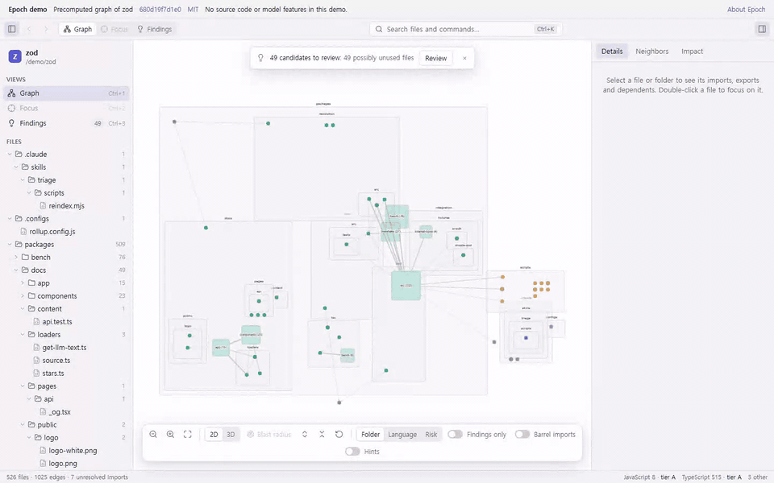
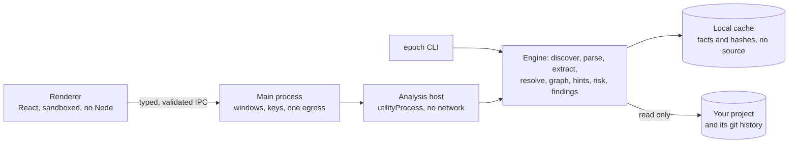

# Epoch

> See how a change moves through a codebase. Epoch maps dependencies, shows blast radius and risk tiers, and surfaces likely dead-feature candidates with evidence and caveats.

Epoch is a local-first desktop app for TypeScript/JavaScript, Python and Go. Open a folder to explore its graph; Epoch reads your project but does not change or execute it. The [browser demo](https://jjun-seo.github.io/Epoch/) uses precomputed graphs from public repositories.



## Why

Before changing a file in an unfamiliar codebase, you want to know three things: what depends on it, how risky it is to touch, and whether the code around it still runs at all. Epoch answers them from the code and its git history, on your machine:

- **Blast radius:** every file that transitively imports the one you select, grouped by folder and language.
- **Risk tiers:** a tier built from three facts you can check (how many files depend on it, how often it changed in the last 90 days, and its size or test coverage), never an opaque score.
- **Candidate findings:** branches that likely never run, possibly stale feature flags, and files no entry point reaches, each with its evidence and caveats.

Edges a resolver proved are facts and drawn solid; anything inferred is a hint, drawn dashed with its evidence. Each language says how precisely it is resolved.

## Try Epoch

| Platform             | Installer                                                                                                                                                                                                                |
| -------------------- | ------------------------------------------------------------------------------------------------------------------------------------------------------------------------------------------------------------------------ |
| macOS, Apple silicon | [Epoch-mac-arm64.dmg](https://github.com/JJUN-SEO/Epoch/releases/latest/download/Epoch-mac-arm64.dmg)                                                                                                                    |
| Windows, x64         | [Epoch-win-x64-setup.exe](https://github.com/JJUN-SEO/Epoch/releases/latest/download/Epoch-win-x64-setup.exe)                                                                                                            |
| Linux, x64           | [Epoch-linux-x64.deb](https://github.com/JJUN-SEO/Epoch/releases/latest/download/Epoch-linux-x64.deb) or [Epoch-linux-x64.AppImage](https://github.com/JJUN-SEO/Epoch/releases/latest/download/Epoch-linux-x64.AppImage) |

The [latest release](https://github.com/JJUN-SEO/Epoch/releases/latest) has notes and [SHA256SUMS.txt](https://github.com/JJUN-SEO/Epoch/releases/latest/download/SHA256SUMS.txt); compare your download's hash with it (`shasum -a 256 <file>` on macOS, `sha256sum <file>` on Linux, `Get-FileHash <file> -Algorithm SHA256` in PowerShell).

The builds are **unsigned**, a deliberate choice for now ([ADR-018](docs/decisions/ADR-018-distribution.md)), so your system warns once:

- **macOS:** if Gatekeeper blocks the app, open System Settings → Privacy & Security and choose **Open Anyway**. Apple silicon only.
- **Windows:** if SmartScreen appears, choose **More info → Run anyway**. Epoch installs for your user only.
- **Linux:** on Ubuntu 24.04, prefer the `.deb`; the AppImage may need FUSE and a compatible AppArmor configuration. Never turn off Chromium's sandbox to run it.

Want Epoch in a script or a CI check instead? See [the command line](docs/cli.md).

## Explore the demos

- [zod · TypeScript](https://jjun-seo.github.io/Epoch/demo.html?repo=zod) — [source at the pinned commit](https://github.com/colinhacks/zod/tree/680d19f7d1e042e55934209caeb79bc843b94f44), MIT.
- [Flask · Python](https://jjun-seo.github.io/Epoch/demo.html?repo=flask) — [source at the pinned commit](https://github.com/pallets/flask/tree/22d924701a6ae2e4cd01e9a15bbaf3946094af65), BSD-3-Clause.
- [GitHub CLI · Go](https://jjun-seo.github.io/Epoch/demo.html?repo=cli) — [source at the pinned commit](https://github.com/cli/cli/tree/d2535897fd14a9c9697f3c6f112ce34007a6bf95), MIT.

Each graph is the exact output of `epoch --offline analyze <repository> --json` at that commit ([the data script](scripts/site-data.mjs)). The demo loads only those files: it cannot read source, dismiss findings, or run a model. The links work once the site's first GitHub Pages deployment has run.

## How it works

Epoch parses files as data, resolves dependency edges, reads local git history for churn and risk, then applies a deterministic findings rubric. It keeps parsed facts in a local cache and updates the graph as files change. The desktop app and the CLI run the same engine:



The [architecture guide](docs/architecture.md) covers the processes, the pipeline, the network boundary and the release flow.

### Privacy

No account, backend or telemetry. Source and the graph stay on your machine; remote model features need your own key and consent, and offline mode blocks every outbound request except a local model you chose. Copied from [docs/privacy.md](docs/privacy.md), which says exactly what each feature sends and where:

<!-- BEGIN GENERATED:privacy -->

| Feature                                                       | What leaves the machine                                                             | Default             |
| ------------------------------------------------------------- | ----------------------------------------------------------------------------------- | ------------------- |
| Parsing, graph, blast radius, risk tiers, git analysis        | Nothing                                                                             | On                  |
| Dead-feature detection (reachability, constants, git history) | Nothing                                                                             | On                  |
| Heuristic scorer, co-change and shared-string hints           | Nothing                                                                             | On                  |
| Embeddings similarity                                         | Nothing (a small local model bundled with the app)                                  | On                  |
| Local-model scorer and summaries (e.g. Ollama)                | Nothing (the model server runs on this machine)                                     | Opt-in              |
| Jev scorer (CLI only)                                         | File excerpts and their context, sent to TypeSafe AI with your key                  | Opt-in              |
| LLM summaries and LLM scorer                                  | File source and neighbor summaries, sent with your key to the provider you choose   | Opt-in              |
| Update check                                                  | One request a day to GitHub Releases for the latest version number; no project data | On; can be disabled |

<!-- END GENERATED:privacy -->

### Findings are candidates

Epoch looks for constant branches, possibly stale flags and possibly unused files. Each finding lists caveats before evidence, a confidence level and a suggested next step. Dynamic imports, framework conventions, tooling and languages outside the analyzed set can hide real uses, so a finding is a prompt to review, never a verdict. Epoch never changes the project. See [the rubric and configuration guide](docs/findings.md).

## Results at a glance

Headline numbers, filled in from the reports by `scripts/readme-tables.mjs` (`pnpm lint` fails if one is edited by hand). [docs/results.md](docs/results.md) has every table, and each report names its repositories, commits, method and limits.

<!-- BEGIN GENERATED:results-at-a-glance -->

| Measure                                                                                        | Result                                                                                   | Report                                                   |
| ---------------------------------------------------------------------------------------------- | ---------------------------------------------------------------------------------------- | -------------------------------------------------------- |
| Full analysis of zod (522 files, empty cache)                                                  | 1.69 s                                                                                   | [performance](docs/benchmarks/typescript-performance.md) |
| The same after editing one file                                                                | 890 ms                                                                                   | [performance](docs/benchmarks/typescript-performance.md) |
| TS/JS edges vs dependency-cruiser, precision / recall (adjusted: each disagreement classified) | zod 100.0% / 100.0%; vitest 100.0% / 100.0%                                              | [TS/JS accuracy](docs/benchmarks/typescript.md)          |
| Python edges vs grimp on Flask, precision / recall (adjusted)                                  | 100.0% / 100.0%                                                                          | [Python accuracy](docs/benchmarks/python-accuracy.md)    |
| Go edges vs `go list` on the GitHub CLI, precision / recall                                    | production 100.0% / 100.0%; tests 99.5% / 100.0%                                         | [Go accuracy](docs/benchmarks/go.md)                     |
| Findings precision on a reviewed sample (reviewed by Claude, not by a human)                   | Worth a look 100.0% (11 yes, 0 no); Maybe 20.5% (8 yes, 31 no)                           | [findings](docs/benchmarks/findings.md)                  |
| Risk tiers in hindsight: share of files fixed in a later window                                | critical 81.4% (48 of 59); low 9.5% (197 of 2081)                                        | [risk](docs/benchmarks/risk.md)                          |
| Hint scorer calibration on a temporal holdout (lower ECE and higher ROC AUC are better)        | shipped heuristic: ECE 0.027, ROC AUC 0.707; constant baseline: ECE 0.015, ROC AUC 0.500 | [scorers](docs/benchmarks/scorers.md)                    |
| Summary cost on Flask with one provider                                                        | full run $0.035; incremental, new and changed files only $0.0063                         | [summaries](docs/benchmarks/summaries.md)                |
| Installer size                                                                                 | macOS 210.3 MB, Windows 200.1 MB, Linux deb 192.5 MB                                     | [installers](docs/benchmarks/installers.md)              |

<!-- END GENERATED:results-at-a-glance -->

## Tradeoffs and limits

Electron carries a full runtime and a local embedding model, which makes installers larger, but it lets the same Node-based engine run in the desktop app and the CLI. Resolver-proven edges are kept apart from heuristic hints; dynamic behavior the resolvers can't follow remains a limit. The static demo cannot show private code or try model features. The app checks for an update but never downloads or installs one.

## Development

```sh
pnpm install
pnpm check
```

Requirements, running the app, the end-to-end tests, benchmarks, the static site and releasing are in [docs/development.md](docs/development.md).

## Documentation

- [docs/cli.md](docs/cli.md): the `epoch` command line, for scripts and CI.
- [docs/results.md](docs/results.md): every measured table.
- [docs/architecture.md](docs/architecture.md): processes, pipeline, network policy and release flow.
- [docs/privacy.md](docs/privacy.md): what leaves the machine, feature by feature.
- [docs/findings.md](docs/findings.md): finding kinds, rubric, configuration and limits.
- [docs/development.md](docs/development.md): building, testing, releasing, repository layout.
- [docs/decisions/](docs/decisions/): architecture decision records.
- [CLAUDE.md](CLAUDE.md) and [PLAN.md](PLAN.md): the rules and data contracts, and the build plan.

## License

[MIT](LICENSE) © 2026 Junhyuk Seo
