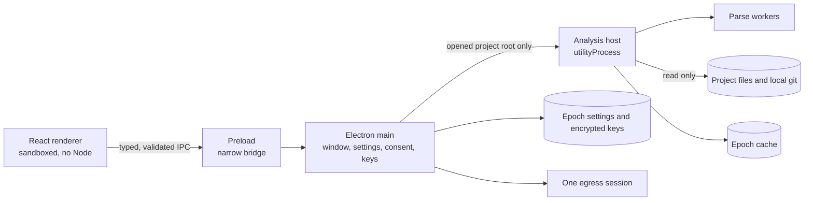
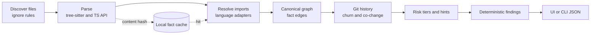
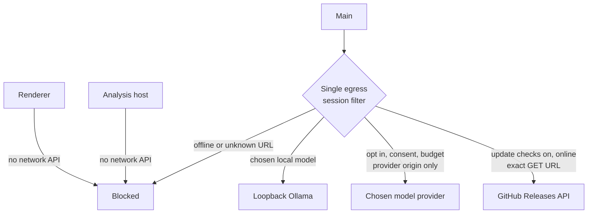
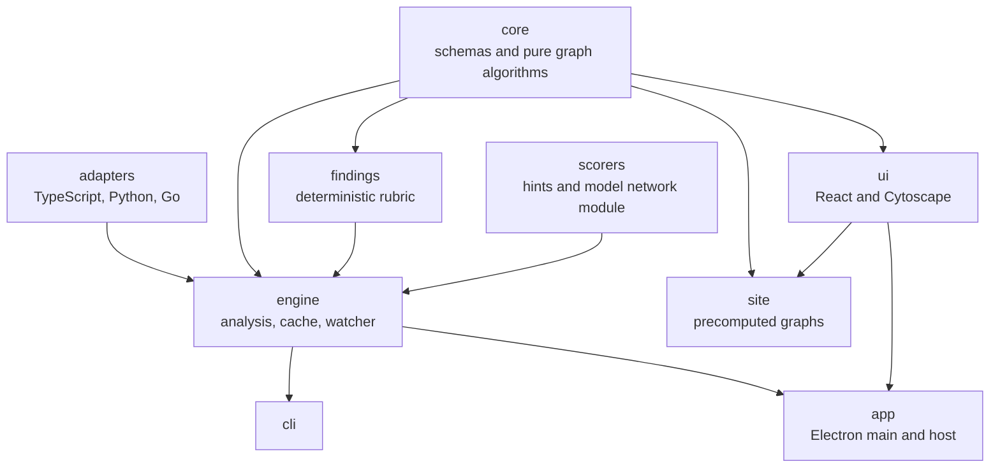
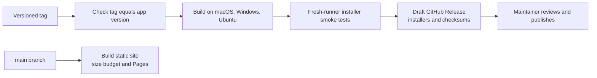

# Architecture

Epoch analyzes a folder without running its code or changing its files. The same engine serves the desktop app and the headless CLI. [CLAUDE.md](../CLAUDE.md) defines the contracts; the [ADR register](../PLAN.md) records design choices.

## Desktop processes and trust boundary

The renderer is isolated from Node, arbitrary filesystem paths and keys. Main validates IPC payloads and senders. The host checks resolved paths and symlinks against the granted project root. Worker threads parse file contents; they never execute the project. The cache holds facts and content hashes, not source code. [ADR-004](decisions/ADR-004-cache-design.md) and [ADR-016](decisions/ADR-016-model-features-in-the-app.md) explain those boundaries.

## Analysis pipeline

Resolver-proven edges are facts. Co-change, shared strings and the optional local embedding model propose **hints**, which are drawn separately and cannot become fact edges or findings. Findings come from a fixed rubric and are candidates for review, with evidence and caveats. [docs/findings.md](findings.md) gives the precise rules.

## Network policy

The app's update check sends no project data or version. Main reads only the latest release tag and builds the browser link from a constant; it does not download an update. Remote model features require the user's key and consent. Offline mode blocks outbound requests, while an explicitly chosen loopback model may still run. The exact data flow is in [docs/privacy.md](privacy.md); [ADR-018](decisions/ADR-018-distribution.md) covers the release check and Electron fuses.

## Shared packages

The static site reuses the UI through `createStaticApi`. Its three JSON graphs are generated by the offline CLI at pinned commits. It has no backend, source previews or model features. The demo page's CSP blocks connections.

## Release path

The smoke tests install the actual packages on clean runners, open a real pinned repository, inspect blast radius and the findings banner, turn on offline mode, and check the complete Chromium network log. Release publication and signing remain maintainer decisions. Installer sizes from a successful matrix run are in [the measured report](benchmarks/installers.md).
